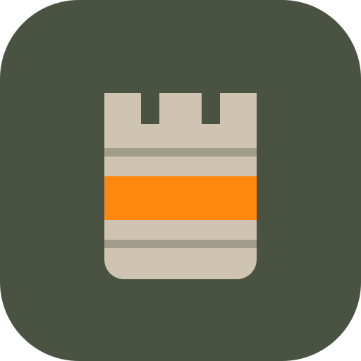
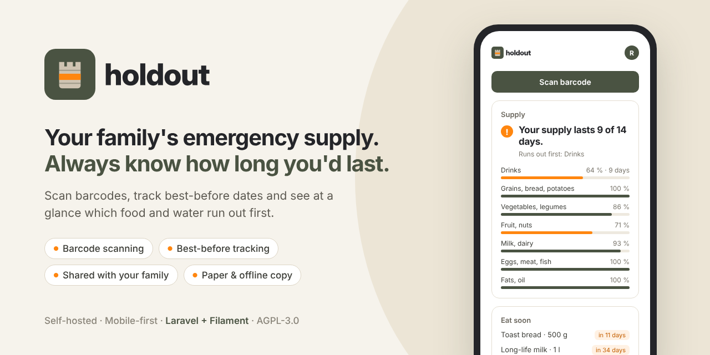

# holdout
### Your family's emergency supply. Always know how long you'd last.

---

Holdout helps a family build an emergency food and water supply, keep it up to date and eat it before it expires. Scan a barcode, enter the best-before date, and the app shows how many days the supply lasts for your household and which category runs out first. It is mobile first, self-hosted and free; everyone in the family signs in without a password. The interface is available in English, German, Spanish, Portuguese and French.

## Installation & quick start

Holdout ships as a ready-made Docker image, built by GitHub Actions and pushed to the GitHub Container Registry, with a PostgreSQL database. You need a small server, a domain with HTTPS and an SMTP account for sign-in links and invitations. No programming required.

1. Create a **PostgreSQL** resource in [Coolify](https://coolify.io) (any Docker Compose host works too).
2. Deploy `deploy/docker-compose.coolify.yml` (app + queue worker for email) and set the environment variables ([Installation](handbuch/Installation.md)).
3. Open the site over HTTPS, **create your household** with its size, and invite the family.
4. Scan what is in your cupboard. The dashboard shows how long it lasts.

Updates are a new image tag; the database is migrated automatically on start. Make a backup first.

## How it works

Holdout calculates a **target amount per category** from the size of your household (adults and children) and how many days the supply should last, using the daily amounts per person from the stock calculator of the German Federal Office for Agriculture and Food (BLE). Every package you add counts towards it until its best-before date; expired food is shown but never counted.

- **Made for the phone:** scan barcodes with the camera, product data and photos come from [Open Food Facts](https://world.openfoodfacts.org) (cached locally, works offline), and Holdout can be added to the home screen.
- **Shared with the family:** one household per installation, everyone with their own account, sign-in with passkeys, email links or an authenticator app. The history shows who took what out.
- **Ready when it counts:** in an emergency the live app may be gone. The **paper printout** and the **offline copy** that every phone keeps on its own still show what you have, where it is and what to eat first.

Holdout consists of a **core** and **modules** that plug in through registries, so new parts can be added without touching the rest.

| Part | What for |
|---|---|
| [Dashboard](handbuch/Dashboard.md) | Days of supply, what to eat soon, recent activity, quick scan |
| [Household](handbuch/Household.md) | Household size, target days, stock against target per category |
| [Products](handbuch/Products.md) & [Scanning](handbuch/Scanning.md) | Products with package size and photo, barcode lookup via Open Food Facts |
| [Batches](handbuch/Batches.md) | How many packages you have and when they expire |
| [Locations](handbuch/Locations.md) | Where the supply is kept: cellar, kitchen, garage |
| [History](handbuch/History.md) | Taking packages out (eaten, thrown away) and who changed what |
| [Shopping list](handbuch/Shopping-list.md) | What is still missing to reach the target, to share or copy |
| [Equipment](handbuch/Equipment.md) | Home pharmacy, power outage, hygiene, documents, cash, grab bag: checklists with expiry dates and a check log |
| [Printout](handbuch/Printout.md) | Paper emergency copy: rations per day, what to eat first, stock by location with a tally column |
| [Offline copy](handbuch/Offline.md) | The same copy on every phone, opened automatically when the server cannot be reached |

Everything else — every page, every setting — is in the **[wiki](../../wiki)**.

## Privacy & security

Holdout runs on your own server; your data goes to nobody else, and there is no telemetry. The only outside call is the barcode lookup at Open Food Facts, which sends just the barcode with a generic identification and can be turned off. There are no passwords to leak: sign-in uses passkeys, single-use email links and an authenticator app as a backup.

Every change runs through code style checks and the full test suite against SQLite and PostgreSQL before an image is built. Please report security issues privately to the maintainer instead of opening a public issue.

## Contributing

Ideas, wishes and bug reports are welcome as an [issue](../../issues/new), ideally with how your family keeps its supply today.

**For developers:** PHP 8.5, Laravel 13, Filament 5, Livewire, Tailwind 4, PostgreSQL (SQLite in tests). The repository opens ready to use in the dev container or GitHub Codespaces; `docker compose up -d` starts the app on port 8080, `php artisan db:seed --class=DemoSeeder` adds a demo household (with `MAIL_MAILER=log`, sign-in links land in `storage/logs/laravel.log`), and `php artisan test` runs the tests. Architecture and rules are in [CLAUDE.md](CLAUDE.md); the [handbook](handbuch/Home.md), from which the wiki is generated, describes every feature, and [Development](handbuch/Development.md) the workflow.

## License

Holdout is free software under the [GNU Affero General Public License v3.0](LICENSE). Every family may use, adapt and share it at no cost. If you offer a modified version to others over a network, you must make its source code available under the AGPL-3.0 as well.
